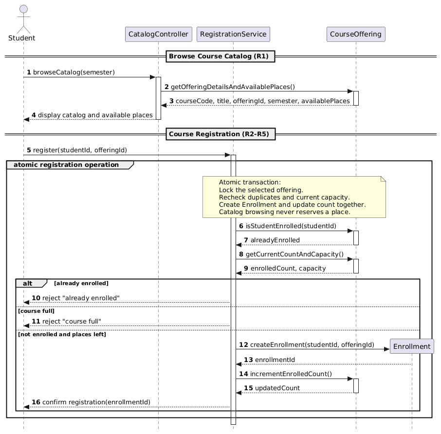
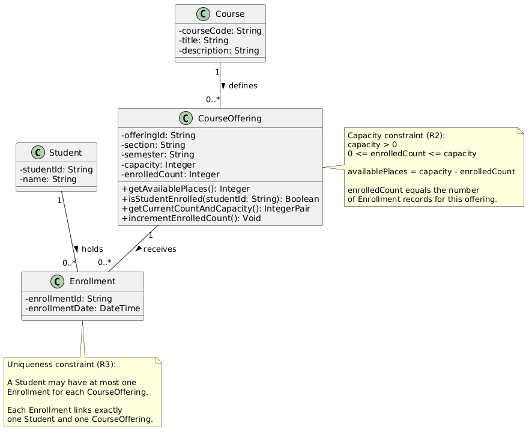
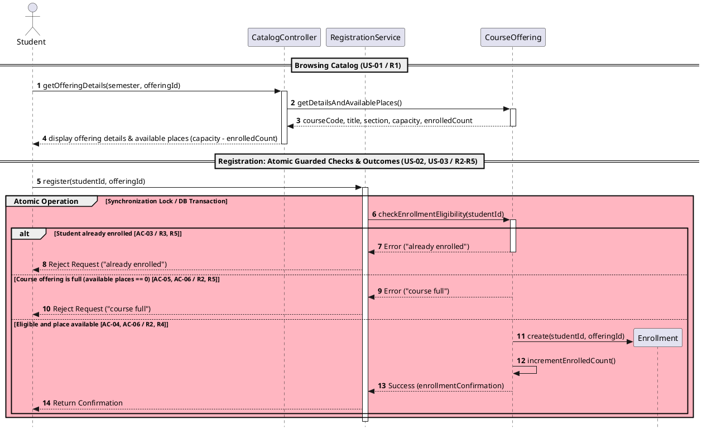
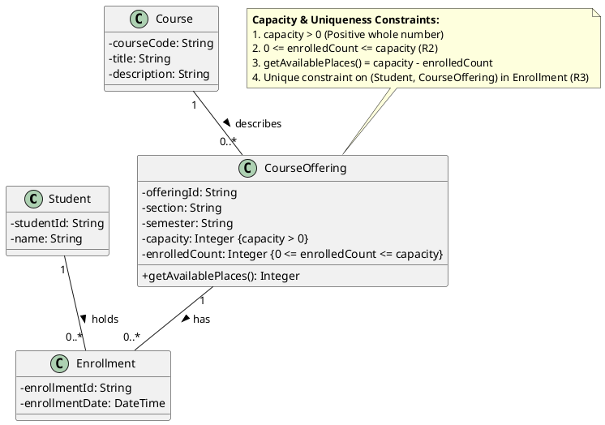
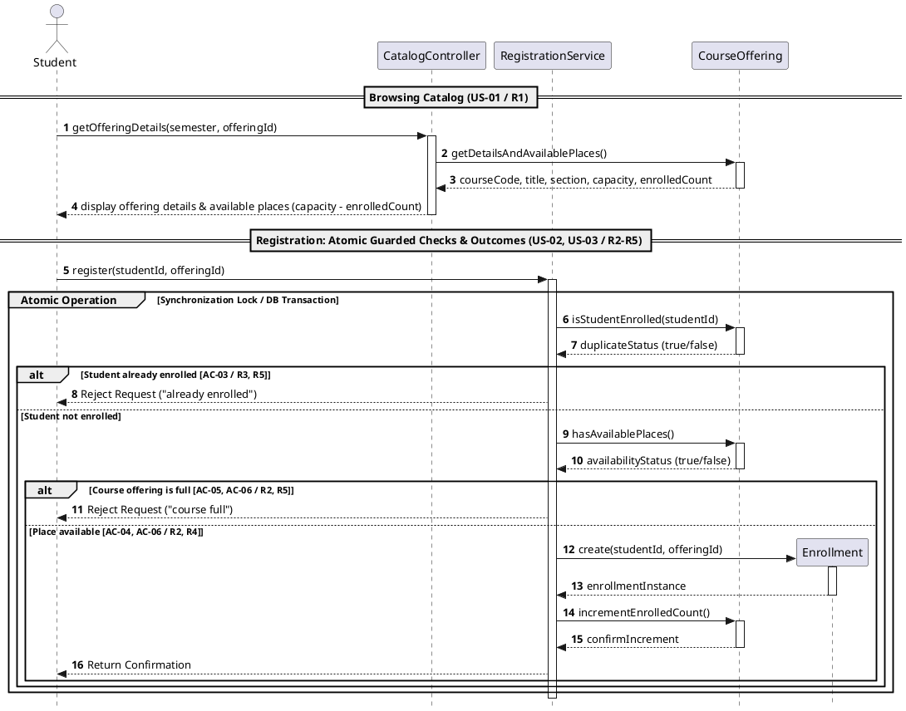
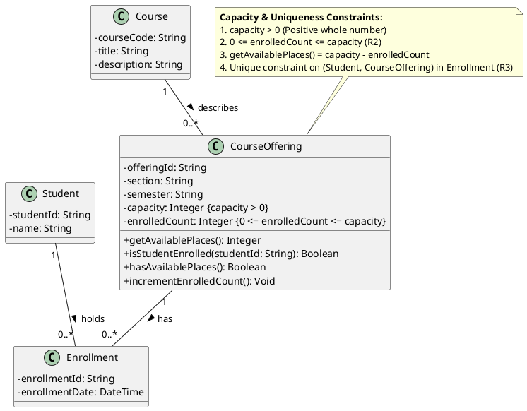
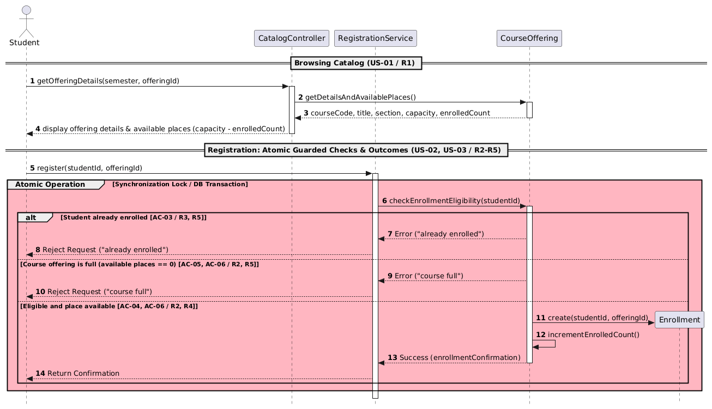
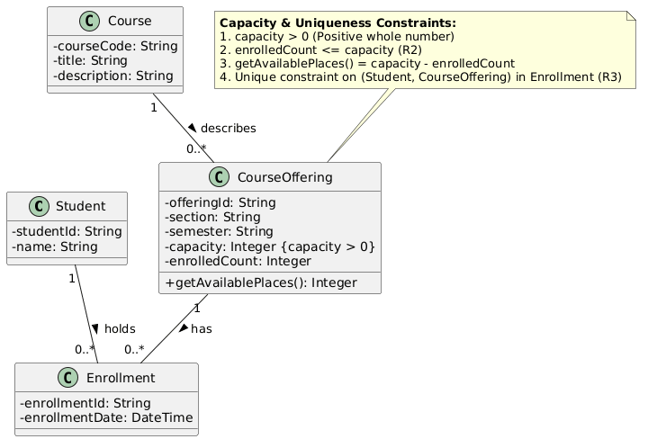

# SIS #02 — AI-Assisted UML Modeling: University Course Registration

<!--
  This is the only file you write your report in. README.md tells you what goes where.

  Rules the checker relies on:
  - Do not delete, rename or renumber the ## headings, the ### headings, or the **Label:** words.
  - Replace every "(write here)" and "(paste here)". None may be left when you submit.
  - Comments like this one are ignored by the checker and the word counter. Delete them or leave them.
-->

## 1. Scope and assumptions

<!-- Your FINAL scope statement and assumptions, after reviewing Prompt A's output. Say here
     what is out of scope (payments, prerequisites, timetable clashes, waiting lists,
     cancellation) — section 2 must not mention them. Section 10 keeps your first version. -->

**Scope:** The university course registration system allows students to browse course offerings for a selected semester and register for available places. The system displays course information, checks current availability, prevents duplicate registrations, and provides confirmation or rejection messages. Registration is handled as an atomic operation to prevent capacity violations.

The system does not include payments, prerequisites, timetable clashes, waiting lists, or cancellation.

**Assumptions:**

1. Students are already authenticated, and the selected course offering exists in the university catalog.
2. Each CourseOffering has a positive capacity, and the available places are calculated using the current enrollment count.
3. Every registration request targets a specific CourseOffering rather than a general Course.
4. Registration checks and Enrollment creation are performed atomically to prevent multiple students from taking the same last place.

## 2. User stories and acceptance criteria

<!-- Your APPROVED requirements: Prompt A's draft after your review. Keep the IDs, the three
     story headings and the bullet shape. Every criterion names the rule(s) it maps to,
     e.g. (R2, R4). Two criteria per story. Nothing out of scope.
     Format of a criterion, on one bullet:
     - **AC-03** (R2, R4): Given ..., When ..., Then ... -->

### US-01 — Browse offerings

**US-01:** As a signed-in student, I want to browse course offerings for a selected semester, so that I can see course information and available places before requesting registration.

- **AC-01** (R1): Given student Alex is signed in and browsing the Fall 2026 catalog, When Alex views the offering for CS101 - Introduction to Computer Science, Then the system displays the course code, title, offering identifier, semester, and current available places.
- **AC-02** (R1): Given student Jordan views a course offering with a capacity of 20 and 15 existing enrollments, When the catalog displays this offering, Then it shows exactly 5 available places without reserving a place for Jordan.


### US-02 — Register for an offering

**US-02:** As a signed-in student, I want to request registration for a specific course offering and receive the result, so that I can enroll when eligible and avoid duplicate registrations.

- **AC-03** (R3, R5): Given student Taylor already has an Enrollment for MATH201 - Section B, When Taylor requests registration for the same offering, Then the system rejects the request with "already enrolled", creates no additional Enrollment, and leaves the enrollment count unchanged.
- **AC-04** (R2, R4): Given student Morgan is not enrolled in ENG102 - Section A and exactly one place remains, When Morgan requests registration and the system performs the final atomic checks, Then the system creates exactly one Enrollment linking Morgan to the offering, reduces available places by one, and returns a confirmation.


### US-03 — Receive a clear rejection

**US-03:** As a signed-in student, I want to receive a clear explanation when my registration cannot be completed, so that I understand why the system rejected my request.

- **AC-05** (R2, R5): Given student Sam requests registration for HIST301 - Section C and the offering has no available places, When the system rechecks capacity during registration, Then it rejects the request with "course full", creates no Enrollment, and leaves the enrollment count unchanged.
- **AC-06** (R2, R4, R5): Given PHYS101 - Section A has exactly one remaining place and two different students submit registration requests concurrently, When the system processes each request atomically, Then exactly one request succeeds and creates one Enrollment, while the other is rejected with "course full" without creating an additional Enrollment or exceeding capacity.

## 3. Sequence diagram



**Participants:** The sequence diagram contains five participants:

1. Student — the user who browses the catalog and requests registration.
2. CatalogController — handles requests to view course offerings and their available places.
3. RegistrationService — processes registration requests and coordinates the required checks.
4. CourseOffering — represents a specific course section and provides enrollment and capacity information.
5. Enrollment — represents the registration record created after a successful request.

**Atomic operation:** The registration process is modeled as one atomic operation. After receiving a registration request, RegistrationService checks whether the student is already enrolled and verifies the current enrollment count against the offering capacity. If the student is not enrolled and places remain, the system creates an Enrollment and updates the enrollment count within the same atomic operation. This prevents two concurrent requests from taking the same last available place. Browsing the catalog does not reserve a place because availability can change before registration.

**Where the Enrollment is created:** The Enrollment is created in the successful registration branch through the message createEnrollment(studentId, offeringId), sent from RegistrationService to Enrollment. This creates an instance of the Enrollment class shown in Section 4. The system updates the enrollment count and returns a confirmation only after successful creation.

**Technical lifelines:** CatalogController and RegistrationService are technical lifelines that are not included in the domain class diagram. CatalogController handles catalog browsing, while RegistrationService coordinates registration logic. They appear in the sequence diagram because it describes system interactions. The class diagram focuses on domain entities and their relationships.

## 4. Class diagram

<!-- The FINAL diagram, rendered. -->



The class diagram contains four main domain classes: Student, Course, CourseOffering, and Enrollment.

| Association | Read left to right | Read right to left |
| --- | --- | --- |
| Course "1" -- "0..*" CourseOffering | One Course can have zero or many CourseOfferings. | Each CourseOffering belongs to exactly one Course. |
| Student "1" -- "0..*" Enrollment | One Student can have zero or many Enrollments. | Each Enrollment belongs to exactly one Student. |
| CourseOffering "1" -- "0..*" Enrollment | One CourseOffering can have zero or many Enrollments. | Each Enrollment belongs to exactly one CourseOffering. |

**How an Enrollment links a student to an offering:** Enrollment represents the relationship between Student and CourseOffering. Each Enrollment is associated with exactly one Student and exactly one CourseOffering. A student may have multiple enrollments in different offerings, but cannot register twice for the same offering.

**Capacity constraint:** Each CourseOffering has a positive capacity, and its enrolledCount must remain between zero and capacity. Available places are calculated as capacity minus enrolledCount. This constraint is written separately because multiplicity alone cannot express a dynamic capacity limit that differs between course offerings.

**Uniqueness constraint:** The combination of Student and CourseOffering must be unique for each Enrollment. This prevents duplicate registrations for the same offering. Multiplicity alone cannot express this constraint because a student may have multiple enrollments across different offerings. The restriction applies specifically to each student-offering pair.

## 5. Traceability

<!-- Every rule, including the catalog fields and availability (R1). Column 1: the rule and
     the criteria that cover it, e.g. "R2 + AC-03, AC-04". Column 2: the message, guard,
     class or constraint that shows the rule in YOUR diagrams. Column 3: the T-ID that
     exercises it, or the extra check you did instead (R1 has no T case). -->

| Rule and criterion | Model evidence | Validation case |
| --- | --- | --- |
| R1 + AC-01, AC-02 | The sequence diagram shows browseCatalog() and getOfferingDetailsAndAvailablePlaces(). The Course class contains courseCode and title, while CourseOffering contains semester, section, and capacity. | Extra catalog check: capacity 20 with 15 enrollments displays 5 available places without reserving a seat. |
| R2 + AC-04, AC-05, AC-06 | RegistrationService calls getCurrentCountAndCapacity() inside the atomic operation. The CourseOffering capacity constraint ensures enrolledCount never exceeds capacity. | T2: The last available place is accepted. T3: A full offering rejects registration. |
| R3 + AC-03 | RegistrationService calls isStudentEnrolled() before creating Enrollment. The class diagram includes a uniqueness constraint for each Student and CourseOffering pair. | T4: Duplicate registration is rejected without creating another Enrollment. |
| R4 + AC-04, AC-06 | The successful branch contains createEnrollment(), incrementEnrolledCount(), and confirm registration(). Each Enrollment links one Student to one CourseOffering. | T1: One Enrollment is created. T2: The final available place is successfully taken. |
| R5 + AC-03, AC-05, AC-06 | The sequence diagram contains rejection branches returning "already enrolled" and "course full". Neither branch creates an Enrollment or updates the enrollment count. | T3: Full-course rejection. T4: Duplicate registration rejection. Both leave the count unchanged. |

## 6. Walkthroughs

<!-- Walk each case through YOUR final sequence diagram, message by message. Column 2: the
     actual steps and the state change (count before → after). Column 3 starts with Pass or
     Fail, then the location: the message, guard or note where you saw it. A Fail you
     report honestly is a finding, not a penalty. -->

| Case | Observed path and state change | Judgment and evidence |
| --- | --- | --- |
| T1. Available | Initial state: capacity = 2, enrolledCount = 0. Student browses the catalog and sends register(studentId, offeringId). RegistrationService calls isStudentEnrolled() and receives false. Then getCurrentCountAndCapacity() returns 0 and 2. The success branch creates one Enrollment through createEnrollment(), increments enrolledCount from 0 to 1, and returns confirmation. One place remains available. | Pass — The "not enrolled and places left" branch creates exactly one Enrollment, updates the count through incrementEnrolledCount(), and returns confirmation after successful creation. |
| T2. Last place | Initial state: capacity = 2, enrolledCount = 1. Student requests registration for the last available place. RegistrationService checks isStudentEnrolled() and receives false. The current capacity check returns enrolledCount = 1 and capacity = 2. The success branch executes createEnrollment() and incrementEnrolledCount(). The enrollment count changes from 1 to 2, leaving zero available places. The student receives confirmation. | Pass — The atomic operation and "not enrolled and places left" branch ensure that the last place is taken successfully without exceeding capacity. |
| T3. Full | Initial state: capacity = 2, enrolledCount = 2. The student previously saw an available place in the catalog, but another registration filled it. Student sends register(studentId, offeringId). RegistrationService checks for duplicates and rechecks current capacity. The capacity check returns 2 of 2. The "course full" branch returns rejection without creating Enrollment or updating enrolledCount. The count remains 2. | Pass — The "course full" guard and rejection message demonstrate that current capacity is checked during the atomic operation. No Enrollment is created and the count stays unchanged. |
| T4. Duplicate | Initial state: capacity = 2, enrolledCount = 1. The student already has an Enrollment for this offering. Student sends another registration request. RegistrationService calls isStudentEnrolled() and receives true. It also checks the current count and capacity before evaluating the alternatives. The "already enrolled" branch rejects the request. No new Enrollment is created, and enrolledCount remains 1. | Pass — The "already enrolled" guard rejects duplicate registration before the creation message. The rejection branch does not update the count or create another Enrollment. |

## 7. Review decisions

<!-- At least three substantive decisions about Prompt C's critique or your own inspection.
     Decision: accepted / rejected / modified — and what you did. Reason: why, in a full
     sentence. Rule: R1–R5. Do not invent an error to fill the table; a justified rejection
     of advice counts. -->

| AI suggestion or model element | Decision | Reason | Rule |
| --- | --- | --- | --- |
| Sequence diagram: incorrect PlantUML closing tags and group ending | Accepted | The original diagrams contain incorrect closing syntax, which prevents reliable rendering. I decided to correct the closing tags and group structure in the final models while preserving the original AI output. | R2, R4 |
| Sequence diagram: Offering activation and deactivation | Accepted | Gemini correctly identified that the Offering lifeline remains active in rejection branches. I accepted the correction because every execution path should finish properly, including duplicate and full-course rejection. | R3, R5 |
| Sequence diagram: Enrollment creation responsibility | Modified | The original sequence diagram does not clearly identify which component creates the Enrollment. I decided that RegistrationService should coordinate creation to make the responsibility clear and ensure exactly one Enrollment is created after successful validation. | R4 |
| Class diagram: enrolledCount constraint | Accepted | The original diagram limits enrolledCount by capacity but does not explicitly prevent negative values. Adding a lower bound makes the domain constraint more complete and keeps available-place calculations consistent. | R2 |
| Sequence diagram: duplicate and capacity checks | Modified | The original checkEnrollmentEligibility method combines multiple validations into one operation. I decided to show duplicate and capacity checks separately so their order and connection to the registration rules are easier to understand. | R2, R3 |
| Original PlantUML diagrams: incorrect closing tags (F1) | Rejected modification of original files; documented known FAIL | The original Gemini response ended both diagrams with @startuml instead of @enduml. Changing these files would violate the requirement to preserve the original AI output. I therefore kept the original sources unchanged and corrected the syntax only in temporary copies used for rendering. The final diagrams contain valid closing tags. | R2, R4 |

## 8. Modeling explanation

<!-- 200–300 words. Your main design choices; how the class diagram and the sequence diagram
     complement each other; why an activity diagram could also help explain the workflow. -->

The university course registration system is modeled using two UML diagrams: a sequence diagram and a class diagram. These diagrams describe different aspects of the same system and help explain how registration works.
The sequence diagram focuses on the interaction between the student and system components. First, the student browses the course catalog and receives information about course offerings and available places. When the student requests registration, RegistrationService checks whether the student is already enrolled and verifies the current capacity of the selected offering.
One important design decision was to model registration as an atomic operation. This means that the final checks, enrollment creation, and count update are performed together. This prevents two students from registering for the same last available place. The sequence diagram also shows three possible outcomes: successful registration, duplicate registration rejection, and full-course rejection.
The class diagram describes the main domain entities: Student, Course, CourseOffering, and Enrollment. It shows their attributes, relationships, and multiplicities. Enrollment connects one student with one specific course offering. Separate constraints ensure that enrollment counts never exceed capacity and that a student cannot register twice for the same offering.
The two diagrams complement each other. The sequence diagram explains the order of operations, while the class diagram explains the structure of the system.
An activity diagram could also be useful because it would show the overall registration workflow, including decision points and alternative outcomes. However, the sequence and class diagrams already provide the main information required for this assignment.

## 9. Reflection

<!-- 150–200 words. Written by you, not by the assistant: where AI helped, one decision you
     made yourself, one remaining limitation. Specific beats flattering. -->

During this assignment, I used AI tools to help develop and review UML diagrams for a university course registration system. Gemini helped generate the initial user stories, acceptance criteria, and PlantUML diagrams. ChatGPT helped me review the requirements, organize the report, and identify additional improvements.
One useful part of the process was comparing the original diagrams with the assignment requirements. The first diagrams contained several problems, including incorrect PlantUML closing tags and unclear validation steps. The AI critique helped identify some issues, but it did not detect everything.
In the final version, I used separate duplicate and capacity checks to make the registration process easier to understand. I also kept the original diagrams separately to demonstrate how the models changed during the assignment.
One limitation is that UML diagrams cannot fully guarantee correct system behavior. For example, an atomic operation is described in the sequence diagram, but an actual application would still need proper transaction handling to prevent concurrent registration problems.
Overall, this assignment showed me that AI can speed up software modeling, but its outputs still require verification against the original requirements.

## 10. Appendix A — Before AI

<!-- Written BEFORE you run Prompt A, committed and pushed in your first commit, and never
     edited afterwards. This is what you paste into Prompt A as "My initial assumptions". -->

**Scope:** The system allows students to browse available university courses and register for specific course offerings. It checks available places, prevents duplicate registrations, and provides confirmation or rejection messages based on the registration result.

**Initial assumptions:**

1. Students are already logged into the system, and each selected course offering exists in the university catalog.
2. Each course offering has a fixed positive capacity, and available places are calculated based on the current number of enrolled students.

## 11. Appendix B — AI exchanges

<!-- Complete prompts and complete responses, as text — never screenshots. Paste each inside
     the ~~~~ block that follows its label: AI responses contain ``` PlantUML blocks, and
     ~~~~ keeps them from breaking this file. Prompts B and C: the prompt text first, then
     the material it refers to ("below", "these two") pasted under it, in the same block.
     You may add B5, B6 … after B4 if you ran more. -->

### B1 — Requirements (Prompt A)

- **Tool:** Gemini
- **Model:** Gemini 3.6 Flash
- **Date:** 2026-10-18
- **Purpose:** draft 3 user stories and 6 acceptance criteria

<!-- Model: the exact model with its version, as the tool shows it (e.g. "GPT-5 Thinking",
     "Claude Sonnet 4.5"). If the tool does not show it, write: not displayed
     Date: YYYY-MM-DD -->

**Prompt:**

~~~~text
Act as a requirements analyst. Use only this course registration scenario and rules R1–R5: A student browses an electronic course catalog, chooses a course offering and requests registration. Each offering has a limited number of places.

A Course describes a subject. A CourseOffering is one scheduled section in one semester. Registration always targets a specific offering.

Assume that the student is signed in, the selected offering exists, and its capacity is a positive whole number.

R1. Catalog: Show the course code, title, offering and available places for one semester.
R2. Capacity: Recheck current availability when registering. Enrollment must never exceed the offering's capacity.
R3. Duplicates: A student may have at most one enrollment in the same offering. Reject a repeat request.
R4. Success: Create exactly one Enrollment linking the student and offering, update availability and return a confirmation.
R5. Rejection: Explain "course full" or "already enrolled". Create no enrollment and leave the enrollment count unchanged.

A catalog view does not reserve a place. Model the final checks and enrollment creation as one atomic operation, so competing requests cannot take the same last place.

Exclude payments, prerequisites, timetable clashes, waiting lists and cancellation. Use fictional students and courses.

My initial assumptions are:
1. Students are already logged into the system, and each selected course offering exists in the university catalog.
2. Each course offering has a fixed positive capacity, and available places are calculated based on the current number of enrolled students.

Draft 3 user stories and 2 Given / When / Then acceptance criteria for each. Use IDs US-01 to US-03 and AC-01 to AC-06. Map each criterion to rule IDs.
Cover normal and rejection behavior. List uncertainty separately. Do not add excluded features or invent university policies.
~~~~

**Response:**

~~~~text
Here is the requirements breakdown based strictly on your scenario and rules R1–R5.

### User Stories

* **US-01: Browse Course Offerings**
As a signed-in student,
I want to view available courses and their details for a selected semester,
So that I can identify which course offerings have open seats before requesting registration.
* **US-02: Register for a Course Offering**
As a signed-in student,
I want to register for a specific course offering with open places,
So that I can secure my enrollment for that course section.
* **US-03: Prevent Invalid Course Registrations**
As a system,
I want to reject duplicate or over-capacity registration requests,
So that enrollment never exceeds course capacity and students cannot enroll twice in the same section.

---

### Acceptance Criteria

| AC ID | User Story | Scenario | Rule Mapping |
| --- | --- | --- | --- |
| **AC-01** | US-01 | **Given** student "Alex" is signed in and browsing the Fall 2026 catalog,<br>

<br>**When** Alex views the entry for Course "CS101 - Introduction to Computer Science",<br>

<br>**Then** the system displays the course code ("CS101"), course title ("Introduction to Computer Science"), offering identifier ("Section A"), and current available places (e.g., "5 available places"). | R1 |
| **AC-02** | US-01 | **Given** student "Jordan" is signed in and views a course offering where 15 out of 20 total places are filled,<br>

<br>**When** the catalog page loads for that semester,<br>

<br>**Then** the system calculates and displays exactly 5 available places without reserving any seats for Jordan. | R1 |
| **AC-03** | US-03 | **Given** student "Taylor" is signed in and requests registration for course offering "MATH201 - Section B",<br>

<br>**And** Taylor already has an active enrollment in "MATH201 - Section B",<br>

<br>**When** the system processes the atomic registration request,<br>

<br>**Then** it rejects the request with the message "already enrolled", creates no new enrollment, and leaves total enrollment count unchanged. | R2, R3, R5 |
| **AC-04** | US-02 | **Given** student "Morgan" is signed in and requests registration for course offering "ENG102 - Section A",<br>

<br>**And** the offering currently has 1 available place and Morgan is not enrolled,<br>

<br>**When** the system executes the atomic registration check and creation,<br>

<br>**Then** it creates exactly 1 Enrollment linking Morgan to "ENG102 - Section A", decreases available places by 1, and returns a registration confirmation. | R2, R4 |
| **AC-05** | US-03 | **Given** student "Sam" is signed in and requests registration for course offering "HIST301 - Section C",<br>

<br>**And** the offering currently has 0 available places (full),<br>

<br>**When** the system performs the atomic availability recheck during registration,<br>

<br>**Then** it rejects the request with the message "course full", creates no enrollment, and leaves total enrollment count unchanged. | R2, R5 |
| **AC-06** | US-03 | **Given** course offering "PHYS101 - Section A" has exactly 1 remaining place,<br>

<br>**And** students "Chris" and "Pat" submit registration requests concurrently,<br>

<br>**When** the system processes the requests as atomic operations,<br>

<br>**Then** exactly one request succeeds creating 1 Enrollment and returning a confirmation, while the second request is rechecked, rejected with "course full", and leaves total capacity unexceeded. | R2, R4, R5 |

---

### Identified Uncertainties

1. **Catalog Refresh Behavior:** Since catalog views do not reserve places and availability is rechecked atomically upon registration, the requirements do not specify whether the catalog display auto-refreshes in real-time or only updates upon user page reload.
2. **Atomic Failure Feedback:** While R5 mandates specific text responses ("course full" or "already enrolled"), it is uncertain if there is a specific error priority when a request simultaneously violates both conditions (e.g., a student attempts to re-register for a course that has also just reached full capacity).
~~~~

### B2 — UML drafts (Prompt B)

- **Tool:** Gemini
- **Model:** Gemini 3.6 Flash
- **Date:** 2026-10-18
- **Purpose:** draft the sequence and class diagrams

**Prompt:**

~~~~text
Using my approved scenario, R1–R5, stories and criteria below, return separate PlantUML code blocks for a sequence diagram and a domain class diagram.
Sequence: include catalog browsing and guarded success, full-course and duplicate outcomes. Model final checks and creation as one atomic operation.
Class: show domain concepts, useful attributes and multiplicities. State the capacity and uniqueness constraints. Explain assumptions and any technical lifelines.

Approved scenario:

A student browses an electronic course catalog, chooses a course offering and requests registration. Each offering has a limited number of places.

A Course describes a subject. A CourseOffering is one scheduled section in one semester. Registration always targets a specific offering.

Assume that the student is signed in, the selected offering exists, and its capacity is a positive whole number.

R1. Catalog: Show the course code, title, offering and available places for one semester.

R2. Capacity: Recheck current availability when registering. Enrollment must never exceed the offering's capacity.

R3. Duplicates: A student may have at most one enrollment in the same offering. Reject a repeat request.

R4. Success: Create exactly one Enrollment linking the student and offering, update availability and return a confirmation.

R5. Rejection: Explain "course full" or "already enrolled". Create no enrollment and leave the enrollment count unchanged.

A catalog view does not reserve a place. Model the final checks and enrollment creation as one atomic operation, so competing requests cannot take the same last place.

Approved requirements:

US-01 — Browse offerings

US-01: As a signed-in student, I want to browse course offerings for a selected semester, so that I can see course information and available places before requesting registration.

AC-01 (R1): Given student Alex is signed in and browsing the Fall 2026 catalog, When Alex views the offering for CS101 - Introduction to Computer Science, Then the system displays the course code, title, offering identifier, semester, and current available places.

AC-02 (R1): Given student Jordan views a course offering with a capacity of 20 and 15 existing enrollments, When the catalog displays this offering, Then it shows exactly 5 available places without reserving a place for Jordan.

US-02 — Register for an offering

US-02: As a signed-in student, I want to request registration for a specific course offering and receive the result, so that I can enroll when eligible and avoid duplicate registrations.

AC-03 (R3, R5): Given student Taylor already has an Enrollment for MATH201 - Section B, When Taylor requests registration for the same offering, Then the system rejects the request with "already enrolled", creates no additional Enrollment, and leaves the enrollment count unchanged.

AC-04 (R2, R4): Given student Morgan is not enrolled in ENG102 - Section A and exactly one place remains, When Morgan requests registration and the system performs the final atomic checks, Then the system creates exactly one Enrollment linking Morgan to the offering, reduces available places by one, and returns a confirmation.

US-03 — Receive a clear rejection

US-03: As a signed-in student, I want to receive a clear explanation when my registration cannot be completed, so that I understand why the system rejected my request.

AC-05 (R2, R5): Given student Sam requests registration for HIST301 - Section C and the offering has no available places, When the system rechecks capacity during registration, Then it rejects the request with "course full", creates no Enrollment, and leaves the enrollment count unchanged.

AC-06 (R2, R4, R5): Given PHYS101 - Section A has exactly one remaining place and two different students submit registration requests concurrently, When the system processes each request atomically, Then exactly one request succeeds and creates one Enrollment, while the other is rejected with "course full" without creating an additional Enrollment or exceeding capacity.
~~~~

**Response:**

~~~~text
Here are the separate PlantUML code blocks for the Sequence Diagram and Domain Class Diagram, followed by technical assumptions and constraint explanations.

### Sequence Diagram

```plantuml
@startuml
skinparam Style strictuml
autonumber

actor "Student" as Student
participant "CatalogController" as Catalog
participant "RegistrationService" as RegService
participant "CourseOffering" as Offering
participant "Enrollment" as Enrollment

== Browsing Catalog (US-01 / R1) ==
Student -> Catalog : getOfferingDetails(semester, offeringId)
activate Catalog
Catalog -> Offering : getDetailsAndAvailablePlaces()
activate Offering
Offering --> Catalog : courseCode, title, section, capacity, enrolledCount
deactivate Offering
Catalog --> Student : display offering details & available places (capacity - enrolledCount)
deactivate Catalog

== Registration: Atomic Guarded Checks & Outcomes (US-02, US-03 / R2–R5) ==
Student -> RegService : register(studentId, offeringId)
activate RegService

group #LightPink Atomic Operation [Synchronization Lock / DB Transaction]
    RegService -> Offering : checkEnrollmentEligibility(studentId)
    activate Offering

    alt Student already enrolled [AC-03 / R3, R5]
        Offering --> RegService : Error ("already enrolled")
        RegService --> Student : Reject Request ("already enrolled")

    else Course offering is full (available places == 0) [AC-05, AC-06 / R2, R5]
        Offering --> RegService : Error ("course full")
        RegService --> Student : Reject Request ("course full")

    else Eligible and place available [AC-04, AC-06 / R2, R4]
        create Enrollment
        Offering -> Enrollment : create(studentId, offeringId)
        Offering -> Offering : incrementEnrolledCount()
        Offering --> RegService : Success (enrollmentConfirmation)
        deactivate Offering
        RegService --> Student : Return Confirmation
    end
end group

deactivate RegService
@startuml

```



---

### Domain Class Diagram


---

### Technical Lifelines & Assumptions

1. **`CatalogController` & `RegistrationService` Lifelines:**
* **`CatalogController`:** Handles non-blocking read operations for browsing course details and calculating available places without acquiring locks or reserving seats (R1).
* **`RegistrationService`:** Encapsulates business logic and coordinates transactional execution for registration requests.


2. **Atomic Operation Realization:**
* To satisfy **R2**, **R4**, **R5**, and concurrent safety (**AC-06**), the sequence diagram models the check-and-create phase inside an **Atomic Group**. Technically, this can be implemented via a database transaction with `SERIALIZABLE` isolation or a pessimistic row lock (`SELECT FOR UPDATE`) on the targeted `CourseOffering`.
* This guarantees that concurrent requests (e.g., Chris and Pat competing for the final seat) are serialized so that only one request can successfully decrement available places and create an `Enrollment`.


3. **Derived Attribute (`availablePlaces`):**
* `availablePlaces` is calculated as `capacity - enrolledCount`. Storing `enrolledCount` directly (or deriving it via `COUNT(Enrollment)`) ensures data consistency without double-booking.
~~~~

### B3 — Model critique (Prompt C)

- **Tool:** Gemini
- **Model:** Gemini 3.6 Flash
- **Date:** 2026-10-18
- **Purpose:** review both models against R1–R5 and T1–T4

**Prompt:**

~~~~text
Review these two UML models against R1–R5 and my acceptance criteria. Check message order, guards, state changes, multiplicities and naming.
Inspect the four validation cases: available places, exactly one place, full course after a stale catalog view, and duplicate registration.
For each issue, cite the affected rule and model element. Explain the impact and propose a focused correction. Separate genuine defects from optional design choices.

Rules:

R1. Catalog: Show the course code, title, offering and available places for one semester.

R2. Capacity: Recheck current availability when registering. Enrollment must never exceed the offering's capacity.

R3. Duplicates: A student may have at most one enrollment in the same offering. Reject a repeat request.

R4. Success: Create exactly one Enrollment linking the student and offering, update availability and return a confirmation.

R5. Rejection: Explain "course full" or "already enrolled". Create no enrollment and leave the enrollment count unchanged.

A catalog view does not reserve a place. The final checks and Enrollment creation must be one atomic operation.

ORIGINAL SEQUENCE DIAGRAM:


ORIGINAL CLASS DIAGRAM:


APPROVED ACCEPTANCE CRITERIA:

AC-01 (R1):
Given student Alex is signed in and browsing the Fall 2026 catalog,
When Alex views the offering for CS101 - Introduction to Computer Science,
Then the system displays the course code, title, offering identifier, semester, and current available places.

AC-02 (R1):
Given student Jordan views a course offering with a capacity of 20 and 15 existing enrollments,
When the catalog displays this offering,
Then it shows exactly 5 available places without reserving a place for Jordan.

AC-03 (R3, R5):
Given student Taylor already has an Enrollment for MATH201 - Section B,
When Taylor requests registration for the same offering,
Then the system rejects the request with "already enrolled", creates no additional Enrollment, and leaves the enrollment count unchanged.

AC-04 (R2, R4):
Given student Morgan is not enrolled in ENG102 - Section A and exactly one place remains,
When Morgan requests registration and the system performs the final atomic checks,
Then the system creates exactly one Enrollment linking Morgan to the offering, reduces available places by one, and returns a confirmation.

AC-05 (R2, R5):
Given student Sam requests registration for HIST301 - Section C and the offering has no available places,
When the system rechecks capacity during registration,
Then it rejects the request with "course full", creates no Enrollment, and leaves the enrollment count unchanged.

AC-06 (R2, R4, R5):
Given PHYS101 - Section A has exactly one remaining place and two different students submit registration requests concurrently,
When the system processes each request atomically,
Then exactly one request succeeds and creates one Enrollment, while the other is rejected with "course full" without creating an additional Enrollment or exceeding capacity.
~~~~

**Response:**

~~~~text
### UML Model & Validation Case Review

Below is the structured review of your sequence and class diagrams against rules **R1–R5**, acceptance criteria **AC-01 through AC-06**, and the four target validation scenarios.

---

### 1. Genuine Defects (Rule & AC Violations)

#### Defect 1: Lifeline Activation Leak & Illegal Control Flow on Rejection Paths

* **Affected Rules / ACs:** R2, R3, R5; AC-03, AC-05, AC-06
* **Affected Model Element:** Sequence Diagram — `activate Offering` / `deactivate Offering` inside `alt` branches.
* **Issue:** `Offering` is activated at message #6 (`checkEnrollmentEligibility`). It is only deactivated inside the *third* branch (`Eligible and place available`). The two error/rejection branches (`Student already enrolled` and `Course offering is full`) return to `RegService` without deactivating `Offering`.
* **Impact:** In UML sequence diagram semantics, an un-deactivated execution specification leaves the lifeline permanently active, representing hanging execution contexts or unreleased synchronous call stacks.
* **Proposed Correction:** Add `deactivate Offering` before returning from both error paths, or move the deactivation to the return point of `checkEnrollmentEligibility` prior to branching.

#### Defect 2: Creation Dependency Order & Execution Context for Object Creation

* **Affected Rules / ACs:** R4; AC-04, AC-06
* **Affected Model Element:** Sequence Diagram — `create Enrollment` (message #14) and `Offering -> Enrollment : create(...)` (message #15).
* **Issue:** Message #14 issues `create Enrollment` from `RegService`'s scope, but message #15 depicts `Offering` calling `create(...)` on `Enrollment`.
* **Impact:** Mismatched caller scope causes control flow ambiguity regarding which component instantiates the domain entity and handles its persistent linkage.
* **Proposed Correction:** Explicitly designate `RegService` or `Offering` as the sole creator. Standard domain model patterns favor `RegService` creating `Enrollment` and passing it to `Offering`, or `Offering` factory-creating `Enrollment` directly (with message #14 originating from `Offering`).

#### Defect 3: Missing Invariant for Non-Negative Enrolled Count

* **Affected Rules / ACs:** R2; AC-02, AC-05
* **Affected Model Element:** Class Diagram — `CourseOffering` note constraints.
* **Issue:** Note constraint #2 specifies `enrolledCount <= capacity` and #1 specifies `capacity > 0`, but there is no explicit lower bound constraint `enrolledCount >= 0`.
* **Impact:** Incomplete domain invariants allow state representations where `enrolledCount` could theoretically become negative, breaking `getAvailablePlaces()` calculations.
* **Proposed Correction:** Update note constraint #2 to: `0 <= enrolledCount <= capacity`.

---

### 2. Optional Design Choices & Improvements

* **Method Naming Alignment:** In the sequence diagram, `Offering` uses `checkEnrollmentEligibility(studentId)` for atomic checks and `incrementEnrolledCount()` for state changes. Adding `registerStudent(studentId)` or explicitly modeling `getAvailablePlaces()` on `Offering` aligns the sequence diagram directly with the class diagram's public interface.
* **Syntax Overhead:** Both PlantUML blocks end with duplicate `@startuml` tags instead of `@enduml`. Replacing the closing tags fixes renderer compilation issues.
* **Primitive Datatypes:** Representing `DateTime` in `Enrollment` can be qualified with standard UML types (`ISO-8601` string or explicit `Timestamp` primitive).

---

### 3. Verification Across Validation Cases

```
+------------------------------------+--------+------------------------------------------------------------+
| Validation Case                    | Status | Notes & Verification                                       |
+------------------------------------+--------+------------------------------------------------------------+
| 1. Available Places Calculation    | PASSED | AC-01, AC-02 (R1): Formula `capacity - enrolledCount`      |
|                                    |        | correctly computes places dynamically without locking.     |
| 2. Exactly One Place Remaining     | PASSED | AC-04 (R2, R4): Atomic path correctly decrements available |
|                                    |        | places by 1 and instantiates exactly 1 Enrollment.         |
| 3. Stale Catalog View / Full Offer | PASSED | AC-05, AC-06 (R2, R5): Rechecking inside the atomic lock   |
|                                    |        | prevents over-subscription even if UI data is stale.       |
| 4. Duplicate Registration Attempt  | PASSED | AC-03 (R3, R5): Rejection guard halts creation and leaves  |
|                                    |        | `enrolledCount` unchanged.                                 |
+------------------------------------+--------+------------------------------------------------------------+

```

---

### 4. Corrected UML Diagrams

#### Corrected Sequence Diagram



#### Corrected Class Diagram


~~~~

### B4 — Focused revision (Prompt D)

- **Tool:** Gemini
- **Model:** Gemini 3.6 Flash
- **Date:** 2026-10-18
- **Purpose:** apply my accepted review decisions

**Prompt:**

~~~~text
Revise the UML sources using only my accepted review decisions: fix the incorrect @startuml closing tags and group ending; correct the Offering lifeline activation and deactivation; clarify Enrollment creation responsibility by making RegistrationService coordinate creation; add the non-negative enrolledCount constraint; and explicitly separate duplicate and capacity checks. Keep justified existing elements and explain each change.
Preserve the agreed scope and rule IDs. Return both updated PlantUML blocks and a concise change log. Flag any unresolved issue.
Approved requirements:

R1. Catalog: Show the course code, title, offering and available places for one semester.
R2. Capacity: Recheck current availability when registering. Enrollment must never exceed the offering's capacity.
R3. Duplicates: A student may have at most one enrollment in the same offering. Reject a repeat request.
R4. Success: Create exactly one Enrollment linking the student and offering, update availability and return a confirmation.
R5. Rejection: Explain "course full" or "already enrolled". Create no enrollment and leave the enrollment count unchanged.

US-01 — Browse offerings

US-01: As a signed-in student, I want to browse course offerings for a selected semester, so that I can see course information and available places before requesting registration.

AC-01 (R1): Given student Alex is signed in and browsing the Fall 2026 catalog, When Alex views the offering for CS101 - Introduction to Computer Science, Then the system displays the course code, title, offering identifier, semester, and current available places.

AC-02 (R1): Given student Jordan views a course offering with a capacity of 20 and 15 existing enrollments, When the catalog displays this offering, Then it shows exactly 5 available places without reserving a place for Jordan.

US-02 — Register for an offering

US-02: As a signed-in student, I want to request registration for a specific course offering and receive the result, so that I can enroll when eligible and avoid duplicate registrations.

AC-03 (R3, R5): Given student Taylor already has an Enrollment for MATH201 - Section B, When Taylor requests registration for the same offering, Then the system rejects the request with "already enrolled", creates no additional Enrollment, and leaves the enrollment count unchanged.

AC-04 (R2, R4): Given student Morgan is not enrolled in ENG102 - Section A and exactly one place remains, When Morgan requests registration and the system performs the final atomic checks, Then the system creates exactly one Enrollment linking Morgan to the offering, reduces available places by one, and returns a confirmation.

US-03 — Receive a clear rejection

US-03: As a signed-in student, I want to receive a clear explanation when my registration cannot be completed, so that I understand why the system rejected my request.

AC-05 (R2, R5): Given student Sam requests registration for HIST301 - Section C and the offering has no available places, When the system rechecks capacity during registration, Then it rejects the request with "course full", creates no Enrollment, and leaves the enrollment count unchanged.

AC-06 (R2, R4, R5): Given PHYS101 - Section A has exactly one remaining place and two different students submit registration requests concurrently, When the system processes each request atomically, Then exactly one request succeeds and creates one Enrollment, while the other is rejected with "course full" without creating an additional Enrollment or exceeding capacity.

Original sources:

ORIGINAL SEQUENCE DIAGRAM:


ORIGINAL CLASS DIAGRAM:


My review decisions and evidence:

1. ACCEPTED — PlantUML syntax correction.
Both original diagrams incorrectly end with @startuml instead of @enduml. The sequence diagram also uses "end group". These syntax problems must be corrected to make the diagrams render properly. Preserve the original files separately.

2. ACCEPTED — Offering activation and deactivation.
Gemini identified that Offering is activated before the alternative branches but deactivated only in the success branch. Every rejection and success path should have consistent activation and deactivation behavior. Affected rules: R3, R5.

3. MODIFIED — Enrollment creation responsibility.
The original diagram ambiguously combines "create Enrollment" with an Offering-to-Enrollment creation message. RegistrationService should coordinate the creation of exactly one Enrollment after the final checks. The creation message must be explicit and confirmation must follow creation. Affected rule: R4.

4. ACCEPTED — Non-negative enrollment count.
The original class diagram states enrolledCount <= capacity but does not explicitly establish the lower bound. Change the constraint to 0 <= enrolledCount <= capacity. Preserve the available places calculation as capacity - enrolledCount. Affected rule: R2.

5. MODIFIED — Duplicate and capacity validation.
The original checkEnrollmentEligibility(studentId) method hides the individual validation steps. Show separate duplicate enrollment and current capacity checks after the registration request and before creating Enrollment. Both checks and creation must remain inside a single atomic operation. Affected rules: R2, R3.

6. PRESERVE — Domain class structure.
Keep the required Student, Course, CourseOffering, and Enrollment classes with their useful attributes and multiplicities. State capacity and uniqueness constraints clearly in the class diagram. Affected rules: R1, R2, R3.

7. PRESERVE — Rejection behavior.
Duplicate registration must return "already enrolled", and full offerings must return "course full". Neither rejection path may create an Enrollment or change the enrollment count. Affected rule: R5.

The final UML diagrams must preserve all five rules R1–R5 and support validation cases T1–T4.
~~~~

**Response:**

~~~~text
### Revised Sequence Diagram



---

### Revised Domain Class Diagram



---

### Change Log

1. **Syntax Fixes:** Changed `@startuml` closing tags to `@enduml` in both files and replaced `end group` with `end` in the sequence diagram.
2. **Lifeline Activation/Deactivation Alignment:** Corrected `Offering` activations so that every call (`isStudentEnrolled`, `hasAvailablePlaces`, `incrementEnrolledCount`) is explicitly deactivated immediately upon returning, eliminating dangling activations across alternative branches (R3, R5).
3. **Enrollment Creation Coordination:** Shifted `Enrollment` instantiation directly to `RegistrationService` (`RegService -> Enrollment : create(...)`). `RegistrationService` now explicitly coordinates creation before updating `Offering`'s count and returning confirmation (R4).
4. **Non-Negative Enrollment Constraint:** Updated `CourseOffering` class attributes and notes to explicitly enforce `0 <= enrolledCount <= capacity` (R2).
5. **Separated Duplicate and Capacity Validations:** Replaced the monolithic `checkEnrollmentEligibility()` with explicit sequential checks: first `isStudentEnrolled(studentId)` for duplicate detection (R3), followed by `hasAvailablePlaces()` for capacity rechecking (R2). Both remain strictly enclosed within the atomic group.

---

### Unresolved Issues / Open Items

* **Error Priority on Combined Rejections:** If a student who is already enrolled submits a request at the exact moment an offering reaches capacity (0 places remaining), the sequence diagram prioritizes returning `"already enrolled"` due to the evaluation order of the duplicate check preceding the capacity check.
~~~~

## 12. Appendix C — Original diagrams

<!-- The AI's first output from Prompt B, rendered unedited from models/original/. -->





## 13. Appendix D — References and source checks

### References

<!-- Full references, one per line, each starting with "- ". Only sources you actually opened.
     Every URL used in the source checks must also appear here. Example:
     - Sommerville, I. (2016). Software Engineering, 10th ed., Global Edition. Pearson. Ch. 5. -->

- PlantUML. Sequence Diagram syntax and features. https://plantuml.com/en/sequence-diagram (Accessed: 2026-10-18).
- PlantUML. Class Diagram syntax and features. https://plantuml.com/class-diagram (Accessed: 2026-10-18).

### Source checks

<!-- At least two modeling decisions you verified. Source and locator: title + slide, page,
     section, chapter or figure — or title + URL + access date (YYYY-MM-DD). Slide numbers
     refer to the decks posted in our Teams. -->

| Modeling decision | Source and locator | What the source says | How it supports or changed your model |
| --- | --- | --- | --- |
| Use alt/else branches for different registration outcomes | PlantUML, Sequence Diagram, section "Grouping message", https://plantuml.com/en/sequence-diagram (Accessed: 2026-10-18) | PlantUML documentation explains that alt and else can represent alternative message sequences, and end closes the group. | This supports the three alternative branches in the final sequence diagram: already enrolled, course full, and successful registration. It also confirms the correct closing syntax. |
| Show multiplicities on both ends of class associations | PlantUML, Class Diagram, section "Label on relations", https://plantuml.com/class-diagram (Accessed: 2026-10-18) | PlantUML documentation explains that cardinality can be specified using double quotes on either side of a class relationship. | This supports the association syntax in the class diagram, including Student "1" to Enrollment "0..*" and CourseOffering "1" to Enrollment "0..*". |
