# SIS #02 — AI-Assisted UML Modeling: University Course Registration

<!--
  This is the only file you write your report in. README.md tells you what goes where.

  Rules the checker relies on:
  - Do not delete, rename or renumber the ## headings, the ### headings, or the **Label:** words.
  - Replace every "(write here)" and "(paste here)". None may be left when you submit.
  - Comments like this one are ignored by the checker and the word counter. Delete them or leave them.
-->

## 1. Scope and assumptions

<!-- Your FINAL scope statement and assumptions, after reviewing Prompt A's output. Say here
     what is out of scope (payments, prerequisites, timetable clashes, waiting lists,
     cancellation) — section 2 must not mention them. Section 10 keeps your first version. -->

**Scope:** The university course registration system allows students to browse course offerings for a selected semester and register for available places. The system displays course information, checks current availability, prevents duplicate registrations, and provides confirmation or rejection messages. Registration is handled as an atomic operation to prevent capacity violations.

The system does not include payments, prerequisites, timetable clashes, waiting lists, or cancellation.

**Assumptions:**

1. Students are already authenticated, and the selected course offering exists in the university catalog.
2. Each CourseOffering has a positive capacity, and the available places are calculated using the current enrollment count.
3. Every registration request targets a specific CourseOffering rather than a general Course.
4. Registration checks and Enrollment creation are performed atomically to prevent multiple students from taking the same last place.

## 2. User stories and acceptance criteria

<!-- Your APPROVED requirements: Prompt A's draft after your review. Keep the IDs, the three
     story headings and the bullet shape. Every criterion names the rule(s) it maps to,
     e.g. (R2, R4). Two criteria per story. Nothing out of scope.
     Format of a criterion, on one bullet:
     - **AC-03** (R2, R4): Given ..., When ..., Then ... -->

### US-01 — Browse offerings

**US-01:** As a signed-in student, I want to browse course offerings for a selected semester, so that I can see course information and available places before requesting registration.

- **AC-01** (R1): Given student Alex is signed in and browsing the Fall 2026 catalog, When Alex views the offering for CS101 - Introduction to Computer Science, Then the system displays the course code, title, offering identifier, semester, and current available places.
- **AC-02** (R1): Given student Jordan views a course offering with a capacity of 20 and 15 existing enrollments, When the catalog displays this offering, Then it shows exactly 5 available places without reserving a place for Jordan.


### US-02 — Register for an offering

**US-02:** As a signed-in student, I want to request registration for a specific course offering and receive the result, so that I can enroll when eligible and avoid duplicate registrations.

- **AC-03** (R3, R5): Given student Taylor already has an Enrollment for MATH201 - Section B, When Taylor requests registration for the same offering, Then the system rejects the request with "already enrolled", creates no additional Enrollment, and leaves the enrollment count unchanged.
- **AC-04** (R2, R4): Given student Morgan is not enrolled in ENG102 - Section A and exactly one place remains, When Morgan requests registration and the system performs the final atomic checks, Then the system creates exactly one Enrollment linking Morgan to the offering, reduces available places by one, and returns a confirmation.


### US-03 — Receive a clear rejection

**US-03:** As a signed-in student, I want to receive a clear explanation when my registration cannot be completed, so that I understand why the system rejected my request.

- **AC-05** (R2, R5): Given student Sam requests registration for HIST301 - Section C and the offering has no available places, When the system rechecks capacity during registration, Then it rejects the request with "course full", creates no Enrollment, and leaves the enrollment count unchanged.
- **AC-06** (R2, R4, R5): Given PHYS101 - Section A has exactly one remaining place and two different students submit registration requests concurrently, When the system processes each request atomically, Then exactly one request succeeds and creates one Enrollment, while the other is rejected with "course full" without creating an additional Enrollment or exceeding capacity.

## 3. Sequence diagram

<!-- The FINAL diagram, rendered. Change .png to .svg if that is what you exported. -->


**Participants:** (write here — each lifeline and what it stands for)

**Atomic operation:** (write here — which messages form the one atomic step: the final duplicate check, the capacity check and the creation of the Enrollment, and why a catalog view reserves nothing)

**Where the Enrollment is created:** (write here — which message, which lifeline, and which class in section 4 it produces)

**Technical lifelines:** (write here — every lifeline that is NOT a class in the class diagram, by name, and why the difference in abstraction is fine. "None" if there are none.)

## 4. Class diagram

<!-- The FINAL diagram, rendered. -->


<!-- One row per association in classes.puml, read in both directions. -->

| Association | Read left to right | Read right to left |
| --- | --- | --- |
| (write here) | (write here) | (write here) |
| (write here) | (write here) | (write here) |
| (write here) | (write here) | (write here) |

**How an Enrollment links a student to an offering:** (write here)

**Capacity constraint:** (write here — and why multiplicity alone cannot express it)

**Uniqueness constraint:** (write here — and why multiplicity alone cannot express it)

## 5. Traceability

<!-- Every rule, including the catalog fields and availability (R1). Column 1: the rule and
     the criteria that cover it, e.g. "R2 + AC-03, AC-04". Column 2: the message, guard,
     class or constraint that shows the rule in YOUR diagrams. Column 3: the T-ID that
     exercises it, or the extra check you did instead (R1 has no T case). -->

| Rule and criterion | Model evidence | Validation case |
| --- | --- | --- |
| R1 + (write here) | (write here) | (write here) |
| R2 + (write here) | (write here) | (write here) |
| R3 + (write here) | (write here) | (write here) |
| R4 + (write here) | (write here) | (write here) |
| R5 + (write here) | (write here) | (write here) |

## 6. Walkthroughs

<!-- Walk each case through YOUR final sequence diagram, message by message. Column 2: the
     actual steps and the state change (count before → after). Column 3 starts with Pass or
     Fail, then the location: the message, guard or note where you saw it. A Fail you
     report honestly is a finding, not a penalty. -->

| Case | Observed path and state change | Judgment and evidence |
| --- | --- | --- |
| T1. Available | (write here) | (write here) |
| T2. Last place | (write here) | (write here) |
| T3. Full | (write here) | (write here) |
| T4. Duplicate | (write here) | (write here) |

## 7. Review decisions

<!-- At least three substantive decisions about Prompt C's critique or your own inspection.
     Decision: accepted / rejected / modified — and what you did. Reason: why, in a full
     sentence. Rule: R1–R5. Do not invent an error to fill the table; a justified rejection
     of advice counts. -->

| AI suggestion or model element | Decision | Reason | Rule |
| --- | --- | --- | --- |
| (write here) | (write here) | (write here) | (write here) |
| (write here) | (write here) | (write here) | (write here) |
| (write here) | (write here) | (write here) | (write here) |

## 8. Modeling explanation

<!-- 200–300 words. Your main design choices; how the class diagram and the sequence diagram
     complement each other; why an activity diagram could also help explain the workflow. -->

(write here)

## 9. Reflection

<!-- 150–200 words. Written by you, not by the assistant: where AI helped, one decision you
     made yourself, one remaining limitation. Specific beats flattering. -->

(write here)

## 10. Appendix A — Before AI

<!-- Written BEFORE you run Prompt A, committed and pushed in your first commit, and never
     edited afterwards. This is what you paste into Prompt A as "My initial assumptions". -->

**Scope:** The system allows students to browse available university courses and register for specific course offerings. It checks available places, prevents duplicate registrations, and provides confirmation or rejection messages based on the registration result.

**Initial assumptions:**

1. Students are already logged into the system, and each selected course offering exists in the university catalog.
2. Each course offering has a fixed positive capacity, and available places are calculated based on the current number of enrolled students.

## 11. Appendix B — AI exchanges

<!-- Complete prompts and complete responses, as text — never screenshots. Paste each inside
     the ~~~~ block that follows its label: AI responses contain ``` PlantUML blocks, and
     ~~~~ keeps them from breaking this file. Prompts B and C: the prompt text first, then
     the material it refers to ("below", "these two") pasted under it, in the same block.
     You may add B5, B6 … after B4 if you ran more. -->

### B1 — Requirements (Prompt A)

- **Tool:** Gemini
- **Model:** Gemini 3.6 Flash
- **Date:** 18.10.2026
- **Purpose:** draft 3 user stories and 6 acceptance criteria

<!-- Model: the exact model with its version, as the tool shows it (e.g. "GPT-5 Thinking",
     "Claude Sonnet 4.5"). If the tool does not show it, write: not displayed
     Date: YYYY-MM-DD -->

**Prompt:**

~~~~text
Act as a requirements analyst. Use only this course registration scenario and rules R1–R5: A student browses an electronic course catalog, chooses a course offering and requests registration. Each offering has a limited number of places.

A Course describes a subject. A CourseOffering is one scheduled section in one semester. Registration always targets a specific offering.

Assume that the student is signed in, the selected offering exists, and its capacity is a positive whole number.

R1. Catalog: Show the course code, title, offering and available places for one semester.
R2. Capacity: Recheck current availability when registering. Enrollment must never exceed the offering's capacity.
R3. Duplicates: A student may have at most one enrollment in the same offering. Reject a repeat request.
R4. Success: Create exactly one Enrollment linking the student and offering, update availability and return a confirmation.
R5. Rejection: Explain "course full" or "already enrolled". Create no enrollment and leave the enrollment count unchanged.

A catalog view does not reserve a place. Model the final checks and enrollment creation as one atomic operation, so competing requests cannot take the same last place.

Exclude payments, prerequisites, timetable clashes, waiting lists and cancellation. Use fictional students and courses.

My initial assumptions are:
1. Students are already logged into the system, and each selected course offering exists in the university catalog.
2. Each course offering has a fixed positive capacity, and available places are calculated based on the current number of enrolled students.

Draft 3 user stories and 2 Given / When / Then acceptance criteria for each. Use IDs US-01 to US-03 and AC-01 to AC-06. Map each criterion to rule IDs.
Cover normal and rejection behavior. List uncertainty separately. Do not add excluded features or invent university policies.
~~~~

**Response:**

~~~~text
Here is the requirements breakdown based strictly on your scenario and rules R1–R5.

### User Stories

* **US-01: Browse Course Offerings**
As a signed-in student,
I want to view available courses and their details for a selected semester,
So that I can identify which course offerings have open seats before requesting registration.
* **US-02: Register for a Course Offering**
As a signed-in student,
I want to register for a specific course offering with open places,
So that I can secure my enrollment for that course section.
* **US-03: Prevent Invalid Course Registrations**
As a system,
I want to reject duplicate or over-capacity registration requests,
So that enrollment never exceeds course capacity and students cannot enroll twice in the same section.

---

### Acceptance Criteria

| AC ID | User Story | Scenario | Rule Mapping |
| --- | --- | --- | --- |
| **AC-01** | US-01 | **Given** student "Alex" is signed in and browsing the Fall 2026 catalog,<br>

<br>**When** Alex views the entry for Course "CS101 - Introduction to Computer Science",<br>

<br>**Then** the system displays the course code ("CS101"), course title ("Introduction to Computer Science"), offering identifier ("Section A"), and current available places (e.g., "5 available places"). | R1 |
| **AC-02** | US-01 | **Given** student "Jordan" is signed in and views a course offering where 15 out of 20 total places are filled,<br>

<br>**When** the catalog page loads for that semester,<br>

<br>**Then** the system calculates and displays exactly 5 available places without reserving any seats for Jordan. | R1 |
| **AC-03** | US-03 | **Given** student "Taylor" is signed in and requests registration for course offering "MATH201 - Section B",<br>

<br>**And** Taylor already has an active enrollment in "MATH201 - Section B",<br>

<br>**When** the system processes the atomic registration request,<br>

<br>**Then** it rejects the request with the message "already enrolled", creates no new enrollment, and leaves total enrollment count unchanged. | R2, R3, R5 |
| **AC-04** | US-02 | **Given** student "Morgan" is signed in and requests registration for course offering "ENG102 - Section A",<br>

<br>**And** the offering currently has 1 available place and Morgan is not enrolled,<br>

<br>**When** the system executes the atomic registration check and creation,<br>

<br>**Then** it creates exactly 1 Enrollment linking Morgan to "ENG102 - Section A", decreases available places by 1, and returns a registration confirmation. | R2, R4 |
| **AC-05** | US-03 | **Given** student "Sam" is signed in and requests registration for course offering "HIST301 - Section C",<br>

<br>**And** the offering currently has 0 available places (full),<br>

<br>**When** the system performs the atomic availability recheck during registration,<br>

<br>**Then** it rejects the request with the message "course full", creates no enrollment, and leaves total enrollment count unchanged. | R2, R5 |
| **AC-06** | US-03 | **Given** course offering "PHYS101 - Section A" has exactly 1 remaining place,<br>

<br>**And** students "Chris" and "Pat" submit registration requests concurrently,<br>

<br>**When** the system processes the requests as atomic operations,<br>

<br>**Then** exactly one request succeeds creating 1 Enrollment and returning a confirmation, while the second request is rechecked, rejected with "course full", and leaves total capacity unexceeded. | R2, R4, R5 |

---

### Identified Uncertainties

1. **Catalog Refresh Behavior:** Since catalog views do not reserve places and availability is rechecked atomically upon registration, the requirements do not specify whether the catalog display auto-refreshes in real-time or only updates upon user page reload.
2. **Atomic Failure Feedback:** While R5 mandates specific text responses ("course full" or "already enrolled"), it is uncertain if there is a specific error priority when a request simultaneously violates both conditions (e.g., a student attempts to re-register for a course that has also just reached full capacity).
~~~~

### B2 — UML drafts (Prompt B)

- **Tool:** Gemini
- **Model:** Gemini 3.6 Flash
- **Date:** 18.10.2026
- **Purpose:** draft the sequence and class diagrams

**Prompt:**

~~~~text
Using my approved scenario, R1–R5, stories and criteria below, return separate PlantUML code blocks for a sequence diagram and a domain class diagram.
Sequence: include catalog browsing and guarded success, full-course and duplicate outcomes. Model final checks and creation as one atomic operation.
Class: show domain concepts, useful attributes and multiplicities. State the capacity and uniqueness constraints. Explain assumptions and any technical lifelines.

Approved scenario:

A student browses an electronic course catalog, chooses a course offering and requests registration. Each offering has a limited number of places.

A Course describes a subject. A CourseOffering is one scheduled section in one semester. Registration always targets a specific offering.

Assume that the student is signed in, the selected offering exists, and its capacity is a positive whole number.

R1. Catalog: Show the course code, title, offering and available places for one semester.

R2. Capacity: Recheck current availability when registering. Enrollment must never exceed the offering's capacity.

R3. Duplicates: A student may have at most one enrollment in the same offering. Reject a repeat request.

R4. Success: Create exactly one Enrollment linking the student and offering, update availability and return a confirmation.

R5. Rejection: Explain "course full" or "already enrolled". Create no enrollment and leave the enrollment count unchanged.

A catalog view does not reserve a place. Model the final checks and enrollment creation as one atomic operation, so competing requests cannot take the same last place.

Approved requirements:

US-01 — Browse offerings

US-01: As a signed-in student, I want to browse course offerings for a selected semester, so that I can see course information and available places before requesting registration.

AC-01 (R1): Given student Alex is signed in and browsing the Fall 2026 catalog, When Alex views the offering for CS101 - Introduction to Computer Science, Then the system displays the course code, title, offering identifier, semester, and current available places.

AC-02 (R1): Given student Jordan views a course offering with a capacity of 20 and 15 existing enrollments, When the catalog displays this offering, Then it shows exactly 5 available places without reserving a place for Jordan.

US-02 — Register for an offering

US-02: As a signed-in student, I want to request registration for a specific course offering and receive the result, so that I can enroll when eligible and avoid duplicate registrations.

AC-03 (R3, R5): Given student Taylor already has an Enrollment for MATH201 - Section B, When Taylor requests registration for the same offering, Then the system rejects the request with "already enrolled", creates no additional Enrollment, and leaves the enrollment count unchanged.

AC-04 (R2, R4): Given student Morgan is not enrolled in ENG102 - Section A and exactly one place remains, When Morgan requests registration and the system performs the final atomic checks, Then the system creates exactly one Enrollment linking Morgan to the offering, reduces available places by one, and returns a confirmation.

US-03 — Receive a clear rejection

US-03: As a signed-in student, I want to receive a clear explanation when my registration cannot be completed, so that I understand why the system rejected my request.

AC-05 (R2, R5): Given student Sam requests registration for HIST301 - Section C and the offering has no available places, When the system rechecks capacity during registration, Then it rejects the request with "course full", creates no Enrollment, and leaves the enrollment count unchanged.

AC-06 (R2, R4, R5): Given PHYS101 - Section A has exactly one remaining place and two different students submit registration requests concurrently, When the system processes each request atomically, Then exactly one request succeeds and creates one Enrollment, while the other is rejected with "course full" without creating an additional Enrollment or exceeding capacity.
~~~~

**Response:**

~~~~text
Here are the separate PlantUML code blocks for the Sequence Diagram and Domain Class Diagram, followed by technical assumptions and constraint explanations.

### Sequence Diagram

```plantuml
@startuml
skinparam Style strictuml
autonumber

actor "Student" as Student
participant "CatalogController" as Catalog
participant "RegistrationService" as RegService
participant "CourseOffering" as Offering
participant "Enrollment" as Enrollment

== Browsing Catalog (US-01 / R1) ==
Student -> Catalog : getOfferingDetails(semester, offeringId)
activate Catalog
Catalog -> Offering : getDetailsAndAvailablePlaces()
activate Offering
Offering --> Catalog : courseCode, title, section, capacity, enrolledCount
deactivate Offering
Catalog --> Student : display offering details & available places (capacity - enrolledCount)
deactivate Catalog

== Registration: Atomic Guarded Checks & Outcomes (US-02, US-03 / R2–R5) ==
Student -> RegService : register(studentId, offeringId)
activate RegService

group #LightPink Atomic Operation [Synchronization Lock / DB Transaction]
    RegService -> Offering : checkEnrollmentEligibility(studentId)
    activate Offering

    alt Student already enrolled [AC-03 / R3, R5]
        Offering --> RegService : Error ("already enrolled")
        RegService --> Student : Reject Request ("already enrolled")

    else Course offering is full (available places == 0) [AC-05, AC-06 / R2, R5]
        Offering --> RegService : Error ("course full")
        RegService --> Student : Reject Request ("course full")

    else Eligible and place available [AC-04, AC-06 / R2, R4]
        create Enrollment
        Offering -> Enrollment : create(studentId, offeringId)
        Offering -> Offering : incrementEnrolledCount()
        Offering --> RegService : Success (enrollmentConfirmation)
        deactivate Offering
        RegService --> Student : Return Confirmation
    end
end group

deactivate RegService
@startuml

```



---

### Domain Class Diagram


---

### Technical Lifelines & Assumptions

1. **`CatalogController` & `RegistrationService` Lifelines:**
* **`CatalogController`:** Handles non-blocking read operations for browsing course details and calculating available places without acquiring locks or reserving seats (R1).
* **`RegistrationService`:** Encapsulates business logic and coordinates transactional execution for registration requests.


2. **Atomic Operation Realization:**
* To satisfy **R2**, **R4**, **R5**, and concurrent safety (**AC-06**), the sequence diagram models the check-and-create phase inside an **Atomic Group**. Technically, this can be implemented via a database transaction with `SERIALIZABLE` isolation or a pessimistic row lock (`SELECT FOR UPDATE`) on the targeted `CourseOffering`.
* This guarantees that concurrent requests (e.g., Chris and Pat competing for the final seat) are serialized so that only one request can successfully decrement available places and create an `Enrollment`.


3. **Derived Attribute (`availablePlaces`):**
* `availablePlaces` is calculated as `capacity - enrolledCount`. Storing `enrolledCount` directly (or deriving it via `COUNT(Enrollment)`) ensures data consistency without double-booking.
~~~~

### B3 — Model critique (Prompt C)

- **Tool:** (write here)
- **Model:** (write here)
- **Date:** (write here)
- **Purpose:** review both models against R1–R5 and T1–T4

**Prompt:**

~~~~text
(paste here)
~~~~

**Response:**

~~~~text
(paste here)
~~~~

### B4 — Focused revision (Prompt D)

- **Tool:** (write here)
- **Model:** (write here)
- **Date:** (write here)
- **Purpose:** apply my accepted review decisions

**Prompt:**

~~~~text
(paste here)
~~~~

**Response:**

~~~~text
(paste here)
~~~~

## 12. Appendix C — Original diagrams

<!-- The AI's first output from Prompt B, rendered unedited from models/original/. -->


## 13. Appendix D — References and source checks

### References

<!-- Full references, one per line, each starting with "- ". Only sources you actually opened.
     Every URL used in the source checks must also appear here. Example:
     - Sommerville, I. (2016). Software Engineering, 10th ed., Global Edition. Pearson. Ch. 5. -->

- (write here)

### Source checks

<!-- At least two modeling decisions you verified. Source and locator: title + slide, page,
     section, chapter or figure — or title + URL + access date (YYYY-MM-DD). Slide numbers
     refer to the decks posted in our Teams. -->

| Modeling decision | Source and locator | What the source says | How it supports or changed your model |
| --- | --- | --- | --- |
| (write here) | (write here) | (write here) | (write here) |
| (write here) | (write here) | (write here) | (write here) |
